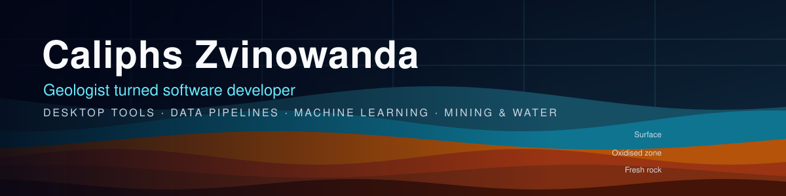
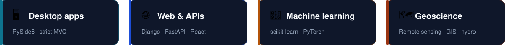
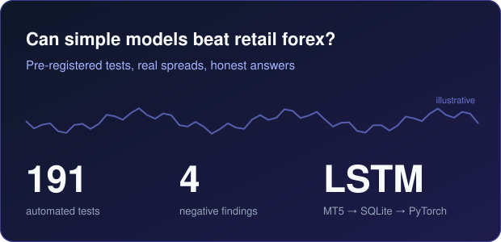

  

  <b>I build desktop tools, data pipelines and machine learning models for mining and environmental teams.</b> 
  South Africa 🇿🇦 · Open to roles and contracts

  
  
  
  
  
  
  
  

  

I started in geology and fieldwork, then taught myself to code so I could build the tools the industry was missing.
Today I work as an independent developer, shipping software for mining and environmental clients.

## Featured projects

<table>
<tr>
<td width="50%" valign="top">

</td>
<td width="50%" valign="top">

### 🛰️ [StrataScope](https://github.com/Caliphsdev/stratascope-releases)
A Windows desktop app for geologists. It guides a user from a study area through Sentinel-2, Landsat and ASTER imagery and SRTM terrain to reproducible maps and A4/A3 reports.
Free pilot, published through MSONICOP. Source is proprietary.

`Python` `PySide6` `Remote sensing` `Windows installer`
</td>
</tr>
<tr>
<td width="50%" valign="top">

### ⚗️ [Digital Reactor](https://github.com/Caliphsdev/digital-reactor)
A research app for tracking PFAS and other emerging contaminants through a lab-scale activated sludge reactor (OECD 303A). Live reactor diagram, mass balance, a two-phase simulation that moves from textbook equations to ML, and digital twins of real plants.

`PySide6` `SQLAlchemy` `scikit-learn` `pytest`
</td>
<td width="50%" valign="top">

</td>
</tr>
<tr>
<td width="50%" valign="top">

</td>
<td width="50%" valign="top">

### 📈 [Forex Machine Learning](https://github.com/Caliphsdev/Forex-machine-learning)
Can simple models find a tradable edge in retail forex? An LSTM pipeline from MT5 to SQLite to PyTorch, with leak-tested walk-forward validation, real recorded spreads and pass marks written down *before* each experiment. Result: four documented negative findings and a reusable test harness.

`Python` `PyTorch` `Time series` `Reproducible research`
</td>
</tr>
</table>

## How I work

- **Architecture first.** Views, models and controllers stay separate, so tools are easy to test and extend.
- **Honest results.** I pre-register what counts as success and report failures as clearly as wins.
- **Domain knowledge.** I understand the geology and hydrology behind the numbers, not just the code.

## Get in touch

📧 [zvinowandacaliphs@gmail.com](mailto:zvinowandacaliphs@gmail.com)

I'm open to roles and contracts where software meets mining, water, environmental science or data.
